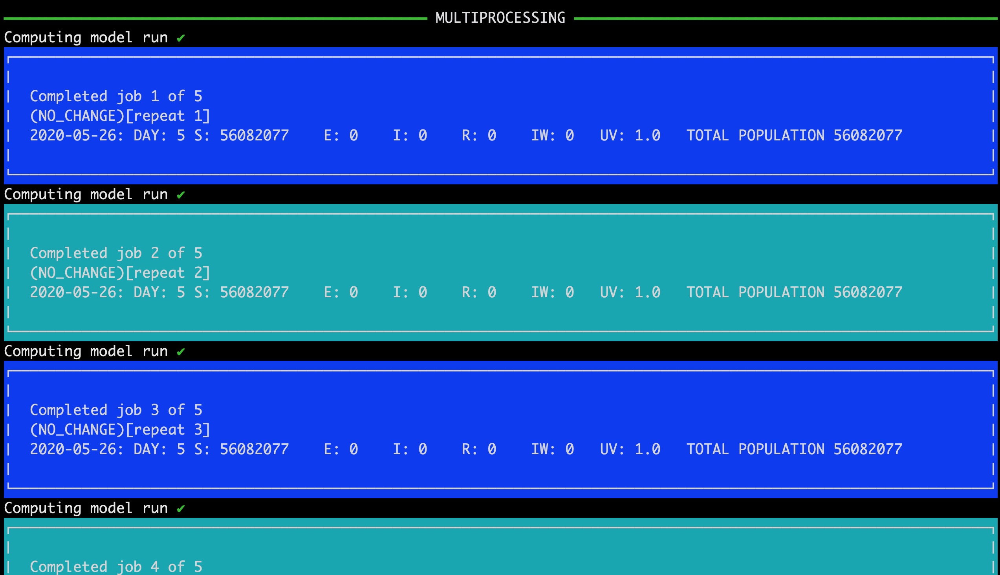

# Summary

Understanding how disease spreads through populations is important when
designing and implementing control measures. [`MetaWards`](https://metawards.org)
implements a stochastic
metapopulation model of disease transmission that enables geographical
modelling of disease spread that can scale all the way from modelling
local transmission up to full national- or international-scale outbreaks.
It is built in Python and has a flexible plugin architecture to
support complex scenario modelling. This enables the code to be adapted
to model new situations and new control measures as they arise, e.g.
emergence of new variants of disease, enaction of different types of
movement restrictions, availability of different types of vaccines etc.
It implements a user-definable compartmental transmission model, such
as an SIR model, that can be
extended multi-dimensionally via multiple demographics or
sub-populations, and multiple geographical regions. It is accelerated
via Cython [@Cython], OpenMP, Scoop [@Scoop] and MPI4Py [@MPI4Py] to scale
efficiently from running on personal laptops to large supercomputers.
Flexible Python, R and command line interfaces and a complete set of tutorials
support researchers adapting the model to a variety of scenarios.

# Statement of need

`MetaWards` was originally developed as a C program to support modelling of disease transmission
in Great Britain [@Danon:2009; @Danon:2010]. The original C code has been
published on GitHub separately [@MetaWards] and is included in the
main `MetaWards` repository for reference. In a metapopulation model,
individuals are divided into different geographical regions, e.g. into
electoral wards as in the original code. Disease transmission between
regions occurs via the daily movement of individuals.

This model was recently adapted to model COVID-19 transmission in England and
Wales [@Danon:2021]. Upon adaption it became clear that the original C
code needed to be made more robust, more trustable, faster, and
easier to extend to model new scenarios. This Python version was created to
meet all of those needs. This Python version of `MetaWards` can
identically reproduce the outputs from the original C code.
It has been optimised and parallelised, with extensive unit testing
added to build trust and robustness. Use of Cython [@Cython] enabled the ported
code to run as quickly as the original C code, and then parallelisation via
OpenMP provided a significant speed-up on multi-core machines.
Re-architecting of the code, including creating a new multi-network (demographic)
framework, enabled extension of the traditional compartmental transmission model
across multiple dimensions; horizontally by adding disease stages,
vertically by adding multiple networks to represent different demographics
or sub-populations, and geographically via movement of modelled individuals
to different custom locations, wards or regions. Finally, a flexible
plugin architecture together with a tutorial-driven development style
has created a flexible modelling framework with a rich set of tutorials and
documentation. These demonstrate
how `MetaWards` can be adapted easily via a Python, R or command-line
interface to model a variety of complex scenarios. `MetaWards` is being
used for on-going modelling of COVID-19 transmission, e.g. via the
model [@UQ4CovidModel] developed by the UQ4Covid project [@UQ4Covid].

# Tutorial-Driven Development

A tutorial-driven development model was used for `MetaWards`. This model
was inspire by test-driven development, where the tests are written first.
For tutorial-driven development, we aimed to write the tutorials first.

Development started with a discussion of the new scenarios that needed
modelling. This was followed with tutorials that described how `MetaWards`
would be used to model those scenarios. Finally, the code (and unit tests)
were written so that `MetaWards` behaved as described in the tutorials.
The project team took the view that if functionality was not described in
a tutorial, then it didn't exist, as users would not know how to make
use of it. The tutorials [@MetaWardsTutorials] evolved in lock-step
with the code. Development was rapid, with new versions released
regularly during 2020. To manage this change, `MetaWards` rigidly
used the semantic versioning (SemVer) scheme [@semver] and provided strong guarantees
of backwards compatibility. The website was versioned, so that
tutorials for older versions of the software were easily accessible
via a drop-down selector. Today, this versioning can be used to
retroactively view how the tutorials developed alongside the code.

# Features

`MetaWards` is designed to enable researchers to model how an infection may
spread geographically (\autoref{fig:geographical}),
and what impact different control measures or individual behaviours
may make.

![Analysis of a simulation run [@GeoSim] that used `MetaWards` to chart disease spread across England and Wales.\label{fig:geographical}](geographical.png)

To this end, `MetaWards` features;

* a generic compartmental tranmission model, with user-definable compartments
  and transmission algorithms. Supports both traditional (e.g. SIR, SEIR, SI, SIS)
  and custom models,
* a flexible plugin architecture that makes it easy to implement new control
  measures. For example, the tutorial shows how this can be used to
  model shielding, different lockdown scenarios and to investigate
  necessary durations of quarantine or self-isolation,
* multi-network demographic support. Multiple networks can be run as a single
  combined group, with custom plugins used to merge data between networks,
  and conditionally move individuals between different demographics.
  Tutorials demonstrate how this can be used to model, for example, shielding and
  self-isolation, hospital admissions, impact of individuals returning
  from holidays,
* per-ward custom parameter support. Different wards can have different
  parameters, meaning that local behaviour can be easily modelled
  (e.g. local lockdowns, changes in local control measures),
* complete-detail and full control over horizontal and vertical movements
  through disease stages or across demographics. Tutorials show how this
  can be used this to model vaccination and also to model waning immunity,
  with individuals returned from the R or V stages back to S,
* flexible data output support - again handled using an array of in-built
  or user-supplied data extraction plugin functions. Data can be output in
  whatever format is needed for analysis, either to text files or to databases,
* full reproducibility support baked in throughout. The code records enough
  data to make reproduction easy, with results designed to be the same given
  the same inputs, random number seed and number of threads,
* flexible input files that would enable modelling of any region or country
  to be undertaken (subject to good input data). Models of the UK and
  England and Wales have been created, and a Python and R API are provided
  to make it easy to create custom networks. These can model everything from
  individual wards or local geographies, up to full national- or
  international-scale metapopulation models,
* support for scanning design files for optimisation or sensitivity analysis
  of nearly all input parameters, plus any user custom parameters used in
  the main code or any plugins. These scans can use as much compute as
  available, parallelising individual runs over multiple cores,
  and scaling multiple runs up to full supercomputers (\autoref{fig:parallel}).

`MetaWards` is optimised and can run happily on small laptops. Individual
national-scale networks fit in approximately 80 MB of memory,
and model runs can take 15-90 seconds to perform. Compute and
memory costs scale with the
number of demographics that are added, but high performance and low memory
consumption are design goals. Models using only a few wards are kilobytes,
and take less than a second to run. Finally, a built-in `metawards-plot` tool
is included in the package for simple visualisation of key results (\autoref{fig:plot}).

# Acknowledgements

Christopher Woods acknowledges funding via an EPSRC Research Software
Engineering Fellowship (EP/N018591/1).  TJM is supported by an "Expanding
Excellence in England" award from Research England and
UKRI grants: EP/V051555/1 (UQ4Covid) and MR/V038613/ (JUNIPER Consortium).

# References
